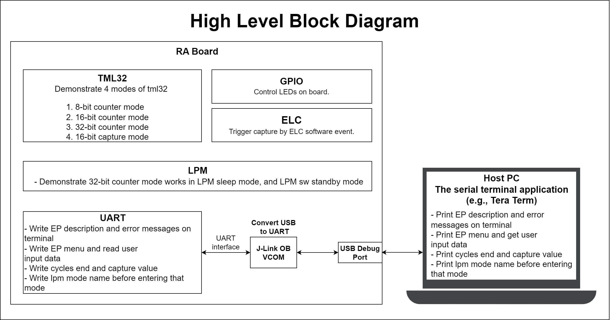
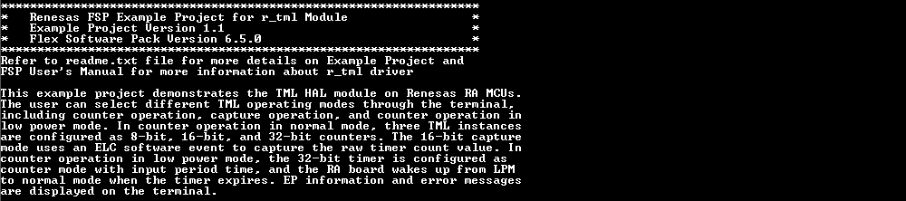
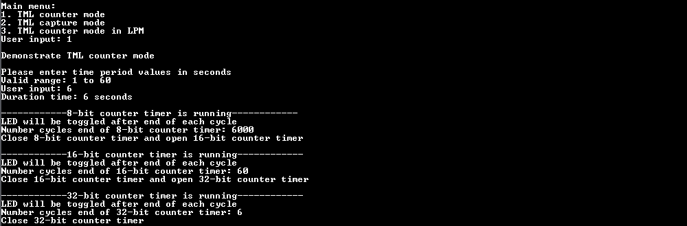
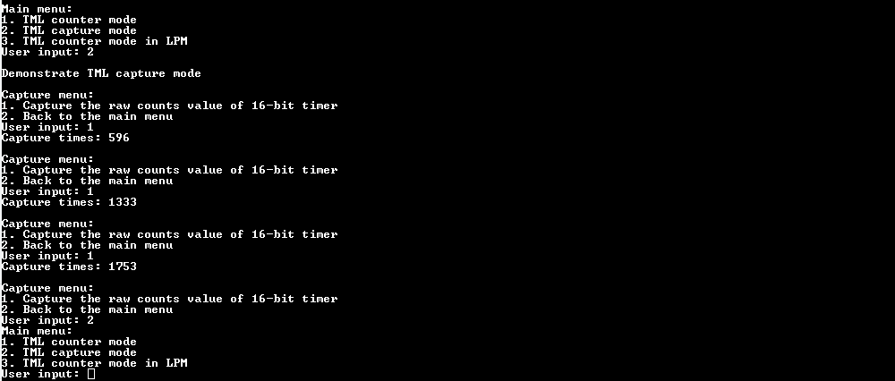
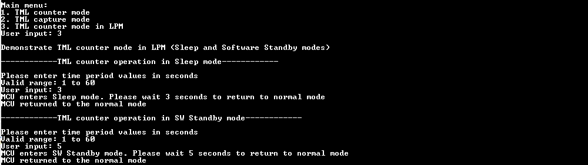

# TML MODES #
# Introduction #
This example project demonstrates the TML HAL module on Renesas RA MCUs. The user can select different TML operating modes through the terminal, including counter operation, capture operation, and counter operation in low power mode. In counter operation in normal mode, three TML instances are configured as 8-bit, 16-bit, and 32-bit counters. The 16-bit capture mode uses an ELC software event to capture the raw timer count value. In counter operation in low power mode, the 32-bit timer is configured as counter mode with input period time, and the RA board wakes up from LPM to normal mode when the timer expires. EP information and error messages are displayed on the terminal.

Please refer to the [Example Project Usage Guide](https://github.com/renesas/ra-fsp-examples/blob/master/example_projects/Example%20Project%20Usage%20Guide.pdf) for general information on example projects and [readme.txt](./readme.txt) for specifics of operation.

## Required Resources ## 
To build and run the TML example project, the following resources are needed.

### Software ###
* Renesas Flexible Software Package (FSP): Version 6.5.0
* e2 studio: Version 2026-04.2
* LLVM Embedded Toolchain for ARM: Version 21.1.1
* Terminal Console Application: Tera Term or a similar application

Refer to the software required section in [Example Project Usage Guide](https://github.com/renesas/ra-fsp-examples/blob/master/example_projects/Example%20Project%20Usage%20Guide.pdf)

### Hardware ###
* Supported RA Boards: FPB-RA0E1, FPB-RA0E2, FPB-RA0L1.
	* 1 x Renesas RA board.
	* 1 x USB cable for programming and debugging (USB cable type varies by board model).

### Hardware Connections ###
* Connect the RA board USB debug port to the host PC using the appropriate USB cable for EP programming and debugging.

* For FPB-RA0E1:
	* The user must close E4, and populate R10 with a resistor ranging from 0 to 150 ohms to use J-Link OB VCOM for Serial Terminal (UART).

* For FPB-RA0E2:
	* The user must close E46, E47 to use J-Link OB VCOM for Serial Terminal (UART).

* For FPB-RA0L1:
	* The user must close E28, E29 to use J-Link OB VCOM for Serial Terminal (UART).
	* The user must place jumper J9 on pins 1-2 to use the on-board debug functionality.

## Related Collateral References ##
The following documents can be referred to for enhancing your understanding of the operation of this example project:
* [FSP User Manual on GitHub](https://renesas.github.io/fsp/)
* [FSP Known Issues](https://github.com/renesas/fsp/issues)

# Project Notes #
## System Level Block Diagram ##
High level block diagram of the system is shown below:
 

## FSP Modules Used ##
List all the various modules that are used in this example project. Refer to the FSP User Manual for further details on each module listed below.

| Module Name | Usage | Searchable Keyword  |
|-------------|-----------------------------------------------|-----------------------------------------------|
| 32-bit Interval Timer | Operating in 8-bit, 16-bit, 32-bit counter modes and 16-bit capture mode. | r_tml |
| Event Link Controller | ELC is used to capture the raw count value of 16-bit timer. | r_elc |
| Low Power Modes | LPM is used to configure power cancellation, mode selection and return the MCU to low power mode to reduce power consumption. | r_lpm |
| I/O Port | I/O Port is used to control on-board LED. | r_ioport |

**Common Configuration Properties for 32-bit Interval Timer**
|   Configure Clock path   |   Default Value   |   Used Value   |   Reason   |
|-----------------------------------------|-------------------|----------------|------------|
| configuration.xml > Clocks > Clocks Configuration | TML FITL0 Src: ELC event/No BSP Source Clock | TML FITL0 Src: FSXP | Select FSXP clock source as the source operating clock for TML FITL0 Source. |
| configuration.xml > Clocks > Clocks Configuration | TML FITL1 Src: ELC event/No BSP Source Clock | TML FITL1 Src: HOCO | Select HOCO clock source as the source operating clock for TML FITL1 Source. |

**Configuration Properties for 8-bit Counter Mode TML instance**

|   Module Property Path and Identifier   |   Default Value   |   Used Value   |   Reason   |
|-----------------------------------------|-------------------|----------------|------------|
| configuration.xml > Stacks > g_timer_8bit 32-bit Interval Timer (r_tml) > Properties > Settings > Property > Common > 16-bit Capture Mode Support | Disabled | Enabled | Enable 16-bit capture mode support. |
| configuration.xml > Stacks > g_timer_8bit 32-bit Interval Timer (r_tml) > Properties > Settings > Property > Common > Interrupt Support | Disabled | Enabled | Enable TML interrupt support. |
| configuration.xml > Stacks > g_timer_8bit 32-bit Interval Timer (r_tml) > Properties > Settings > Property > Module g_timer_8bit 32-bit Interval Timer (r_tml) > General > Mode | 8-bit Counter Mode | 8-bit Counter Mode | Select TML 8-bit Counter mode. |
| configuration.xml > Stacks > g_timer_8bit 32-bit Interval Timer (r_tml) > Properties > Settings > Property > Module g_timer_8bit 32-bit Interval Timer (r_tml)  > Counter Mode Settings > Period | 0x10000 | 1 | Set specific the timer period is 1. |
| configuration.xml > Stacks > g_timer_8bit 32-bit Interval Timer (r_tml) > Properties > Settings > Property > Module g_timer_8bit 32-bit Interval Timer (r_tml)  > Counter Mode Settings > Period Unit | Raw Counts | Milliseconds | Set unit of period is milliseconds. |
| configuration.xml > Stacks > g_timer_8bit 32-bit Interval Timer (r_tml) > Properties > Settings > Property > Module g_timer_8bit 32-bit Interval Timer (r_tml)  > Interrupt > Callback function | NULL | timer_8bit_callback | A user callback function. It is called from the interrupt service routine (ISR) each time when event occurs. |
| configuration.xml > Stacks > g_timer_8bit 32-bit Interval Timer (r_tml) > Properties > Settings > Property > Module g_timer_8bit 32-bit Interval Timer (r_tml)  > Interrupt > Priority | Disabled | Priority 2 | Select the interrupt priority is 2. |

**Configuration Properties for 16-bit Counter Mode TML instance**

|   Module Property Path and Identifier   |   Default Value   |   Used Value   |   Reason   |
|-----------------------------------------|-------------------|----------------|------------|
| configuration.xml > Stacks > g_timer_16bit 32-bit Interval Timer (r_tml) > Properties > Settings > Property > Module g_timer_16bit 32-bit Interval Timer (r_tml) > General > Mode | 8-bit Counter Mode | 16-bit Counter Mode | Select TML 16-bit Counter mode. |
| configuration.xml > Stacks > g_timer_16bit 32-bit Interval Timer (r_tml) > Properties > Settings > Property > Module g_timer_16bit 32-bit Interval Timer (r_tml) > Counter Mode Settings > Period | 0x10000 | 100 | Set specific the timer period is 100. |
| configuration.xml > Stacks > g_timer_16bit 32-bit Interval Timer (r_tml) > Properties > Settings > Property > Module g_timer_16bit 32-bit Interval Timer (r_tml) > Counter Mode Settings > Period Unit | Raw Counts | Milliseconds | Set unit of period is milliseconds. |
| configuration.xml > Stacks > g_timer_16bit 32-bit Interval Timer (r_tml) > Properties > Settings > Property > Module g_timer_16bit 32-bit Interval Timer (r_tml) > Interrupt > Callback function | NULL | timer_16bit_callback | A user callback function. It is called from the interrupt service routine (ISR) each time when event occurs. |
| configuration.xml > Stacks > g_timer_16bit 32-bit Interval Timer (r_tml) > Properties > Settings > Property > Module g_timer_16bit 32-bit Interval Timer (r_tml) > Interrupt > Priority | Disabled | Priority 2 | Select the interrupt priority is 2. |

**Configuration Properties for 32-bit Counter Mode TML instance**

|   Module Property Path and Identifier   |   Default Value   |   Used Value   |   Reason   |
|-----------------------------------------|-------------------|----------------|------------|
| configuration.xml > Stacks > g_timer_32bit 32-bit Interval Timer (r_tml) > Properties > Settings > Property > Module g_timer_32bit 32-bit Interval Timer (r_tml) > General > Mode | 8-bit Counter Mode | 32-bit Counter Mode | Select TML 32-bit Counter mode. |
| configuration.xml > Stacks > g_timer_32bit 32-bit Interval Timer (r_tml) > Properties > Settings > Property > Module g_timer_32bit 32-bit Interval Timer (r_tml) > Counter Mode Settings > Period | 0x10000 | 1 | Set specific the timer period is 1. |
| configuration.xml > Stacks > g_timer_32bit 32-bit Interval Timer (r_tml) > Properties > Settings > Property > Module g_timer_32bit 32-bit Interval Timer (r_tml) > Counter Mode Settings > Period Unit | Raw Counts | Seconds | Set unit of period is seconds. |
| configuration.xml > Stacks > g_timer_32bit 32-bit Interval Timer (r_tml) > Properties > Settings > Property > Module g_timer_32bit 32-bit Interval Timer (r_tml) > Interrupt > Callback function | NULL | timer_32bit_callback | A user callback function. It is called from the interrupt service routine (ISR) each time when event occurs. |
| configuration.xml > Stacks > g_timer_32bit 32-bit Interval Timer (r_tml) > Properties > Settings > Property > Module g_timer_32bit 32-bit Interval Timer (r_tml) > Interrupt > Priority | Disabled | Priority 2 | Select the interrupt priority is 2. |

**Configuration Properties for 16-bit Capture Mode TML instance**

|   Module Property Path and Identifier   |   Default Value   |   Used Value   |   Reason   |
|-----------------------------------------|-------------------|----------------|------------|
| configuration.xml > Stacks > g_timer_16bit_capture 32-bit Interval Timer (r_tml) > Properties > Settings > Property > Module g_timer_16bit_capture 32-bit Interval Timer (r_tml) > General > Mode | 8-bit Counter Mode | 16-bit Capture Mode | Select TML 16-bit Capture mode. |
| configuration.xml > Stacks > g_timer_16bit_capture 32-bit Interval Timer (r_tml) > Properties > Settings > Property > Module g_timer_16bit_capture 32-bit Interval Timer (r_tml) > General > ELC event | Disable | ELC SOFTWARE EVENT 0 (Software event 0) | Select the ELC event. |
| configuration.xml > Stacks > g_timer_16bit_capture 32-bit Interval Timer (r_tml) > Properties > Settings > Property > Module g_timer_16bit_capture 32-bit Interval Timer (r_tml) > Capture Mode Settings > Capture Trigger | Software trigger | Event input from ELC (rising edge) | Select ELC as capture trigger source. |
| configuration.xml > Stacks > g_timer_16bit_capture 32-bit Interval Timer (r_tml) > Properties > Settings > Property > Module g_timer_16bit_capture 32-bit Interval Timer (r_tml) > Capture Mode Settings > Capture Clock Divider | fITL0 | fITL0/128 | Divide capture clock by 128. |
| configuration.xml > Stacks > g_timer_16bit_capture 32-bit Interval Timer (r_tml) > Properties > Settings > Property > Module g_timer_16bit_capture 32-bit Interval Timer (r_tml) > Capture Mode Settings > Counter Status | Retained after the completion of capturing | Retained after the completion of capturing | Selection of the 16-bit counter value after capturing. |
| configuration.xml > Stacks > g_timer_16bit_capture 32-bit Interval Timer (r_tml) > Properties > Settings > Property > Module g_timer_16bit_capture 32-bit Interval Timer (r_tml) > Interrupt > Callback function | NULL | timer_16bit_capture_callback | A user callback function. It is called from the interrupt service routine (ISR) each time when event occurs. |
| configuration.xml > Stacks > g_timer_16bit_capture 32-bit Interval Timer (r_tml) > Properties > Settings > Property > Module g_timer_16bit_capture 32-bit Interval Timer (r_tml) > Interrupt > Priority | Disabled | Priority 2 | Select the interrupt priority is 2. |

**Configuration Properties for 32-bit Counter Mode TML instance operates in LPM**

|   Module Property Path and Identifier   |   Default Value   |   Used Value   |   Reason   |
|-----------------------------------------|-------------------|----------------|------------|
| configuration.xml > Stacks > g_timer_32bit_counter_lpm 32-bit Interval Timer (r_tml) > Properties > Settings > Property > Module g_timer_32bit_counter_lpm 32-bit Interval Timer (r_tml) > General > Mode | 8-bit Counter Mode | 32-bit Counter Mode | Select TML 32-bit Counter mode. |
| configuration.xml > Stacks > g_timer_32bit_counter_lpm 32-bit Interval Timer (r_tml) > Properties > Settings > Property > Module g_timer_32bit_counter_lpm 32-bit Interval Timer (r_tml) > Counter Mode Settings > Period | 0x10000 | 0x10000 | The timer period will be set according to user input. |

**Configuration Properties for Sleep mode LPM instance**
|   Module Property Path and Identifier   |   Default Value   |   Used Value   |   Reason   |
|-----------------------------------------|-------------------|----------------|------------|
| configuration.xml > Stacks > g_lpm_sleep Low Power Modes (r_lpm) > Properties > Settings > Property > Module g_lpm_sleep Low Power Modes (r_lpm) > General > Low Power Mode | Sleep mode | Sleep mode | Select sleep mode for this LPM instance. |

**Configuration Properties for SW Standby mode LPM instance**
|   Module Property Path and Identifier   |   Default Value   |   Used Value   |   Reason   |
|-----------------------------------------|-------------------|----------------|------------|
| configuration.xml > Stacks > g_lpm_sw_standby Low Power Modes (r_lpm) > Properties > Settings > Property > Module g_lpm_sw_standby Low Power Modes (r_lpm) > General > Low Power Mode | Sleep mode | Software Standby mode | Select Software Standby mode for this LPM instance. |
| configuration.xml > Stacks > g_lpm_sw_standby Low Power Modes (r_lpm) > Properties > Settings > Property > Module g_lpm_sw_standby Low Power Modes (r_lpm) > Deep Sleep and Standby Options > Wake Sources > 32-bit interval timer interrupt | ☐ | ☑ | Select 32-bit interval timer interrupt as the source to cancel SW Standby mode. |

## API Usage ##
The table below lists the FSP provided API used at the application layer in this example project.

| API Name    | Usage                                                                          |
|-------------|--------------------------------------------------------------------------------|
| R_TML_Open | This API is used to initialize the timer module. |
| R_TML_Close | This API is used to de-initialize the timer module. |
| R_TML_Start | This API is used to start the TML timer. |
| R_TML_Stop | This API is used to stop the TML timer. |
| R_TML_StatusGet | This API is used to get timer status. |
| R_TML_InfoGet | This API is used to get timer frequency. |
| R_TML_PeriodSet | This API is used to set period count for timer. |
| R_ELC_Open | This API is used to initialize all the links in the Event Link Controller. |
| R_ELC_Enable | This API is used to enable the operation of the Event Link Controller. |
| R_ELC_Close |	This API is used to disable ELC linking. |
| R_ELC_SoftwareEventGenerate |	This API is used to generate a software event in the Event Link Controller. |
| R_LPM_Open | This API is used to initialize the LPM module. |
| R_LPM_LowPowerModeEnter |	This API is used to enter low power mode. |
| R_LPM_Close |	This API is used to de-initialize the LPM module. |
| R_IOPORT_PinWrite | This API is used to control LED state. |
| R_BSP_SoftwareDelay | This API is used to delay a specified period of time. |

## Verifying Operation ##
1. Set up the hardware connection properly mentioned in [Hardware Connections](#hardware-connections).
2. Import, generate, build, and download project to the RA board.
3. Open a serial terminal application (e.g., Tera Term) to view output, configure the settings as follows:
	* To make sure the received data shows properly, the user needs to set:
		* [Setup] -> [Terminal...] -> [New-line] -> Select [Receive: CR] & [Transmit: CR].

	* To echo back characters typed in Tera Term, the user needs to enable it through:
		* [Setup] -> [Terminal...] -> Check [Local echo].

	* The configuration parameters of the serial port on the serial terminal application:
		* Port: The port is provided by the J-Link On-Board.
		* Speed: 115200
		* Data: 8 bit
		* Parity: none
		* Stop bits: 1 bit
		* Flow control: none

**The images below showcase the output**

The EP information:

TML counter mode operation:

TML capture mode operation:

TML counter mode operates in low power mode:

